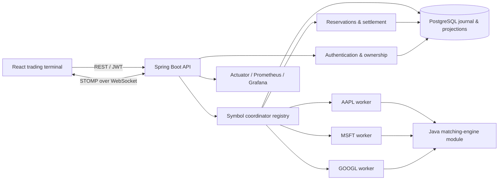

<div align="center">

# ExchangeX

### Durable, Concurrent, Multi-Instrument Exchange Simulator

**Java 21 · Spring Boot 4.1.2 · PostgreSQL 17 · Spring Security/JWT · React · WebSocket/STOMP · Docker Compose**

[](https://github.com/Akasherf/ExchangeX/actions/workflows/ci.yml)
[](https://github.com/Akasherf/ExchangeX/actions/workflows/release-readiness.yml)

**[Quick start](INSTALL.md) · [Architecture](#architecture) · [Capabilities](#capabilities) · [Verification](#testing-and-verification) · [Documentation](#documentation)**

</div>

> **Scope:** ExchangeX is an educational, local-first stock-exchange **simulator**. It does not execute real-market orders, hold real funds or claim regulatory certification. This is a portfolio engineering system, not a production brokerage.

## Overview

ExchangeX accepts authenticated limit-order commands, sequences work through per-symbol matching coordinators, matches bids and asks using **price-time priority**, and stores commands, execution results, accounting events and checkpoints in PostgreSQL. Separate React and WebSocket components expose market state and authenticated account activity.

The principal design goal is **correctness under concurrency and restarts**, not a large number of loosely coupled services. The matching logic is an independent Java module; the Spring Boot API coordinates transactions, authorization, reservations and persistence.

## Capabilities

| Area | Implementation |
| --- | --- |
| Matching | Limit BUY/SELL orders, FIFO within price levels, maker-price fills, partial fills and cancellations |
| Concurrency | Per-instrument single-writer processing with durable command admission |
| Durability | PostgreSQL command journal, trade/order projections, checkpoints and startup recovery |
| Safety | Exclusive PostgreSQL writer lease, fencing generation, idempotent order submission and defensive self-trade prevention |
| Accounts | Simulated cash/share reservations, settlement, journalled ledger events and balance audits |
| Security | JWT authentication, password hashing, ownership checks and request/WebSocket guards |
| Instruments | Isolated matching books for AAPL, MSFT and GOOGL |
| Realtime UI | React/Vite trading terminal, market snapshots and WebSocket/STOMP notifications; REST resynchronization |
| Operations | Docker Compose, health/readiness probes, Prometheus, Grafana and backup/restore tooling |
| Quality | JUnit, PostgreSQL integration suites, Compose smoke and release-readiness GitHub Actions |

The WebSocket feed is best-effort, not a guaranteed delivery ledger. Accounts start without simulated funding; no public endpoint grants money or holdings.

## Architecture



All three symbol coordinators run inside a **single Spring Boot process**. Exclusive writer fencing protects the single active writer; this is not a distributed active-active matching cluster.

**Order lifecycle:** authenticated submission → transactional admission and reservation → committed command sequence → single-writer match/cancel → transactional trade, ledger and checkpoint updates → REST and best-effort WebSocket observation.

## Repository layout

```text
ExchangeX/
├── .github/workflows/          # Java/PostgreSQL, frontend, Docker and release checks
├── matching-engine/            # Framework-independent matching and unit tests
├── exchange-api/               # Spring Boot API, security, JDBC/Flyway, integration tests
├── exchange-web/               # React + Vite trading terminal
├── monitoring/                 # Prometheus and Grafana configuration
├── deploy/                     # Deployment examples
├── scripts/                    # Smoke, backup, restore and invariant audit tools
├── docs/
│   ├── development/            # Archived sprint implementation notes
│   ├── operations/             # Backup and disaster-recovery runbook
│   ├── releases/               # Evidence-based release acceptance
│   ├── matching-rules.md
│   └── requirements.md
├── compose.yaml
├── .env.example
├── INSTALL.md                  # Current local installation
└── pom.xml                     # Maven multi-module parent
```

## Quick start

**Prerequisites:** Docker Desktop/Engine with Compose v2, OpenSSL and suitable available memory. The Compose stack builds the Java 21 backend and React frontend; a separate host Maven/Node installation is not required for Docker startup.

```bash
git clone https://github.com/Akasherf/ExchangeX.git
cd ExchangeX
bash scripts/init-local-env.sh
docker compose up --build -d --wait --wait-timeout 240
bash scripts/smoke-compose.sh
```

Open the **trading terminal** at [http://127.0.0.1:8088](http://127.0.0.1:8088). Additional loopback-only endpoints: API `8085`, Prometheus `9091`, Grafana `3000`. No services should be exposed to the public internet without a separately reviewed secure deployment.

The environment generator preserves an existing `.env` file. **Do not delete or regenerate credentials for an existing database volume.** Stop services without deleting volumes using `docker compose down` (never `down -v` when preserving data). Detailed commands and troubleshooting: [INSTALL.md](INSTALL.md).

## Testing and verification

Local Java and frontend suites:

```bash
mvn -B -ntp clean verify
python3 scripts/check-test-reports.py
(cd exchange-web && npm ci --no-audit --no-fund && npm run build)
```

With the isolated/local Compose stack started:

```bash
bash scripts/smoke-compose.sh
bash scripts/audit-financial-invariants.sh
```

Automated workflows: [ExchangeX CI](https://github.com/Akasherf/ExchangeX/actions/workflows/ci.yml) and [release-readiness](https://github.com/Akasherf/ExchangeX/actions/workflows/release-readiness.yml). They cover separate levels of assurance, including duplicate-writer rejection, backup/isolated restore and read-only financial audits. A controlled PostgreSQL outage under in-flight trading requires **separate fault-injection evidence**; do not infer that result from a normal restart.

See [v1.0.0 release acceptance](docs/releases/v1.0.0-rc1-verification.md) for gate-by-gate evidence and outstanding items. Only the GitHub Releases page determines whether an official v1.0.0 tag has actually been published.

## Design notes

- **Priority:** best price first, then insertion time within the same price level; execution uses the resting order's price.
- **Amounts:** integer ticks and quantities avoid floating-point comparison errors; balances are abstract simulation units.
- **Admission vs execution:** a committed order receipt does not itself establish a completed trade.
- **Recovery:** durable journal replay and checkpoints reconstruct state; writer fencing prevents concurrent generations from committing stale transactions.
- **Risk boundaries:** simulated account balances, best-effort WebSockets and local Compose hosting are deliberate project limits. No benchmark throughput claims are made without reproducible measurements.

## Documentation

- [Current installation](INSTALL.md)
- [Matching rules](docs/matching-rules.md) · [Requirements](docs/requirements.md)
- [Backup, recovery and operational runbook](docs/operations/RELEASE_7C.md)
- [Release acceptance criteria](docs/releases/v1.0.0-rc1-verification.md)
- [Archived development milestones](docs/development/README_SPRINT4_ARCHIVE.md) — implementation history, not current setup instructions

## Author

**Akash Kumar** — [GitHub @Akasherf](https://github.com/Akasherf)

Built to demonstrate Java backend engineering, concurrent state machines, transaction boundaries, idempotency and recovery in a realistic simulated exchange workflow.
