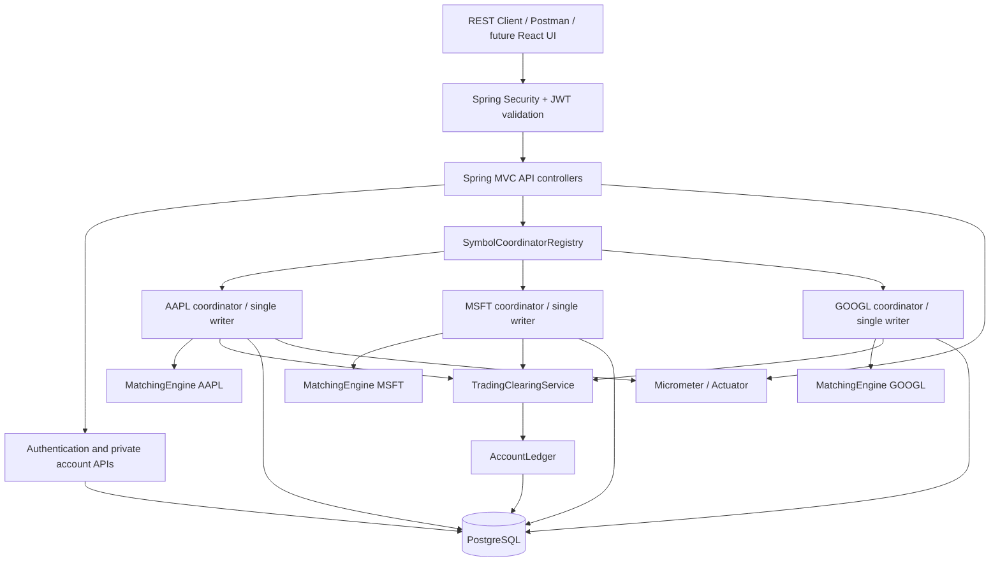
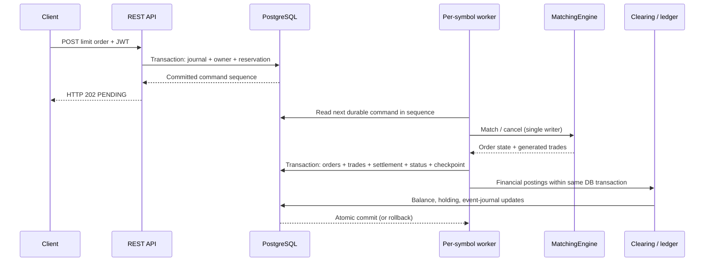
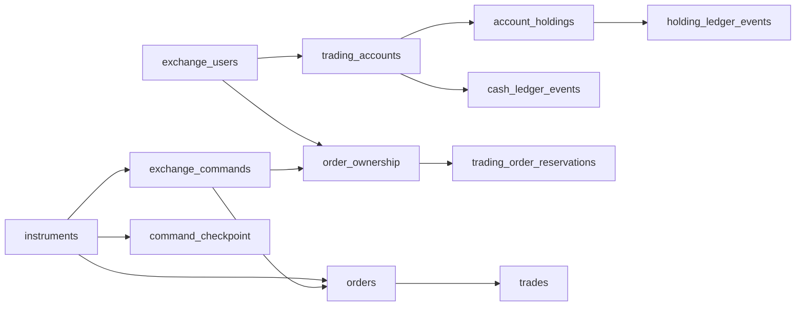

> Archived historical project overview. This document describes an earlier milestone and is preserved for development history, **not** current deployment or release status.

<div align="center">

# ExchangeX

### A Durable, Concurrent, Multi-Instrument Stock Exchange Simulator

**Java 21 · Spring Boot 4.1.2 · PostgreSQL 17 · Spring Security · JWT · Spring JDBC · Flyway · Maven**

*A backend engineering project exploring how an exchange accepts, sequences, matches, settles, and recovers limit orders.*

**Created and maintained by Akash Kumar**

Java Backend Developer · B.Tech Computer Science (2026)


**[Overview](#overview) · [Architecture](#architecture) · [Features](#implemented-features) · [Run locally](#getting-started) · [API](#rest-api-reference) · [Testing](#testing-and-verification) · [Roadmap](#current-limitations-and-planned-roadmap)**

</div>

> [!IMPORTANT]
> **ExchangeX is a learning and portfolio-grade exchange *simulator*.** It does **not** connect to a real stock exchange, place real trades, handle actual money, or provide brokerage services. Prices, balances, and securities are simulated. A passing test suite is not a production security or financial-systems certification.

## Documentation

- [Current installation and Docker deployment](#getting-started) — use the current Compose/CI workflow, not historical patch-application notes.
- [Architecture and matching rules](docs/matching-rules.md)
- [Requirements](docs/requirements.md)
- [Sprint 5: WebSocket and React (historical)](docs/development/SPRINT5_SETUP.md)
- [Sprint 6: Docker and monitoring (historical)](docs/development/SPRINT6_SETUP.md)
- [Sprint 7A: Trading hardening (historical)](docs/development/SPRINT7_HARDENING.md)
- [Sprint 7B: Security and reliability (historical)](docs/development/SPRINT7B_SECURITY_RELIABILITY.md)
- [Backup and disaster-recovery runbook](docs/operations/RELEASE_7C.md)
- [v1.0.0 release acceptance checklist](docs/releases/v1.0.0-rc1-verification.md)

## Overview

I built ExchangeX to explore backend engineering beyond a conventional CRUD application. The objective was to design a system in which **order matching is deterministic**, **concurrent requests have a defined execution order**, **commands survive application restarts**, and **every simulated trade has consistent cash and stock accounting**.

The project started as a pure-Java price/time-priority matching engine. Across four implementation sprints, it evolved into a modular Spring Boot backend with a PostgreSQL-backed command journal, durable replay, JWT authentication, ownership enforcement, simulation trading accounts, atomic reservations and settlements, and separate order books for multiple instruments.

Rather than splitting everything into microservices prematurely, I chose a **modular monolith**: the matching rules remain a standalone Java module, while the API module owns database persistence, authentication, financial accounting, observability, and process lifecycle.

**Current milestone:** Multi-module exchange simulator with the Java matching engine, PostgreSQL-backed trading API, React/Vite dashboard, WebSocket streaming, Docker Compose deployment, monitoring, and CI/recovery tooling implemented. The project is undergoing evidence-based v1.0.0 release verification; passing checks do not certify production financial-system readiness. See [release verification](docs/releases/v1.0.0-rc1-verification.md) for the acceptance gates.

### Engineering problems addressed

- How can limit orders match using **best price first, then FIFO** without nondeterministic results?
- How can many HTTP threads submit orders while a **single writer** mutates each book?
- What should an API return when an order has been **durably admitted but not executed yet**?
- How can the application recover if it crashes after computing a trade but before committing all related database changes?
- How can a user be prevented from reading, cancelling, or reusing another user's order ID?
- How can BUY cash and SELL shares be **reserved before matching**, then settled **exactly once**?
- How can AAPL, MSFT, and GOOGL trade independently while retaining a globally unique client order ID namespace?
- How can correctness be verified through **database integration tests, concurrency tests, and deliberate failure injection**?

## Implemented features

| Area | Implemented behavior |
| --- | --- |
| **Matching engine** | BUY/SELL limit orders, price-time priority, resting-price executions, partial fills, multiple fills, cancellations, duplicate-order checks |
| **Concurrency** | Durable admission from concurrent callers; per-symbol single-writer matching worker; bounded outstanding-command admission |
| **Persistence** | PostgreSQL-backed commands, order states, trades, checkpoints, and Flyway migrations |
| **Recovery** | Rebuild committed order-book state, restore trade history, replay outstanding commands after the last committed checkpoint |
| **Idempotency** | Unique submitted order IDs; repeat submissions are not admitted as new orders; ledger event keys prevent duplicate postings |
| **Security** | Registration/login, BCrypt password hashes, HS256 JWT access tokens, issuer/audience checks, protected order and account operations |
| **Ownership** | Submitter associated with orders durably; cross-account lookups and cancellations rejected without revealing other users' orders |
| **Trading balances** | Per-user available/reserved cash and per-symbol available/reserved holdings; read-only private account APIs |
| **Financial controls** | Pre-admission BUY/SELL reservations, insufficient-balance rejection, exact-integer risk limits, settlement, price-improvement refunds, cancellation release |
| **Multi-instrument** | Separate AAPL, MSFT, and GOOGL matching coordinators, books, and recovery checkpoints; symbol-scoped REST routes |
| **Observability** | Spring Boot Actuator, Micrometer counters/timers, health indicator, correlation IDs, database-backed backlog/checkpoint gauges |
| **Verification** | JUnit/MockMvc/PostgreSQL tests, fault injection, restart/replay tests, concurrent-account tests, optional local throughput benchmark |

## Tech stack

| Layer | Technology | Purpose |
| --- | --- | --- |
| Language/runtime | **Java 21** | Records, strong typing, immutable inputs, exact integer arithmetic |
| Web/application | **Spring Boot 4.1.2**, Spring MVC | REST endpoints, dependency injection, application lifecycle |
| Authentication | **Spring Security**, OAuth2 Resource Server, Nimbus JOSE | Stateless signed-JWT validation and access rules |
| Password security | **BCrypt** | One-way hashing of user passwords |
| Database | **PostgreSQL 17** | Durable commands, account state, trades, event journals, checkpoints |
| Data access | **Spring JDBC / `JdbcTemplate`** | Explicit SQL and row-level locking rather than opaque ORM updates |
| Transactions | **Spring transactions / `TransactionTemplate`** | Commit and rollback command, settlement, and checkpoint changes together |
| Schema management | **Flyway** | Versioned migrations V1–V5 |
| Metrics | **Micrometer + Actuator**, Prometheus registry | Counters, timings, health and metrics exposure |
| Testing | **JUnit 5, Spring Test, MockMvc, Awaitility, Mockito** | Matching, HTTP, security, concurrency, recovery, fault-injection tests |
| Build | **Maven multi-module reactor** | Reproducible builds for engine and API |

### Why no separate matching microservice yet?

Deterministic order sequencing and atomic financial settlement are easier to reason about when the book worker, journal, and transaction boundary are designed together. Module boundaries let the system evolve later without claiming that its current process-local coordination is distributed or horizontally scalable.

## Architecture



The diagram is a **logical architecture**, not a depiction of separate network services. All three coordinators currently live inside **one Spring Boot process**.

### Modules and responsibilities

**`matching-engine/`** — framework-independent Java domain logic. Holds the `Order`, `Side`, `Trade`, and `OrderView` types; price-level books; matching/cancellation logic; and engine-specific tests. This module does not require Spring or PostgreSQL to execute its unit tests.

**`exchange-api/`** — Spring Boot application. Hosts REST contracts, durable coordinator, symbol registry, Spring Security, account ledger/clearing service, JDBC repositories, Flyway migrations, metrics, and integration tests.

### Repository layout

```text
Exchangex/
├── pom.xml                              # Maven reactor / shared configuration
├── matching-engine/
│   ├── pom.xml
│   └── src/
│       ├── main/java/com/exchangex/engine/
│       │   ├── MatchingEngine.java
│       │   ├── OrderCommandProcessor.java
│       │   ├── Order.java
│       │   ├── OrderView.java
│       │   ├── Trade.java
│       │   └── Side.java
│       └── test/java/com/exchangex/engine/
└── exchange-api/
    ├── pom.xml
    └── src/
        ├── main/java/com/exchangex/api/
        │   ├── ExchangeApiApplication.java
        │   ├── ExchangeConfig.java
        │   ├── OrderController.java
        │   ├── DurableCommandCoordinator.java
        │   ├── SymbolCoordinatorRegistry.java
        │   ├── SecurityConfig.java
        │   ├── CommandLifecycleObserver.java
        │   ├── FailureInjection.java
        │   ├── auth/
        │   │   ├── AuthController.java
        │   │   ├── AuthService.java
        │   │   ├── JwtTokenService.java
        │   │   └── ExchangeUserRepository.java
        │   ├── accounts/
        │   │   ├── AccountController.java
        │   │   ├── AccountLedger.java
        │   │   └── TradingClearingService.java
        │   ├── repository/              # Spring JDBC persistence interfaces + implementations
        │   └── observability/           # Metrics, health, request tracing
        ├── main/resources/
        │   ├── application.properties
        │   ├── application-test.properties
        │   ├── application-postgres-integration.properties
        │   └── db/migration/
        │       ├── V1__initial_schema.sql
        │       ├── V2__durable_execution.sql
        │       ├── V3__users_and_order_ownership.sql
        │       ├── V4__trading_accounts_and_ledgers.sql
        │       └── V5__funded_orders_and_instruments.sql
        └── test/java/com/exchangex/api/
            ├── SecurityOwnershipIntegrationTest.java
            ├── CrashRecoveryIntegrationTest.java
            ├── FundedRecoveryIntegrationTest.java
            ├── MultiSymbolIntegrationTest.java
            ├── accounts/
            │   ├── AccountLedgerIntegrationTest.java
            │   └── FundedTradingIntegrationTest.java
            ├── observability/
            └── benchmark/
```

Other regression suites cover the controller, JDBC persistence, fault injection, concurrency, and coordinator behavior. Local development notes and internal planning documents are intentionally excluded from this public source tree.

## Matching engine: rules and data structures

ExchangeX supports **limit orders**, not market, stop, or iceberg orders.

### Price-time priority

| Book | Preferred price | Tie-breaker |
| --- | --- | --- |
| BUY / bids | Higher price first | Earlier resting order first |
| SELL / asks | Lower price first | Earlier resting order first |

Internally, `MatchingEngine` uses:

- A **descending `TreeMap<Long, Deque<...>>`** for bid price levels.
- An **ascending `TreeMap<Long, Deque<...>>`** for ask price levels.
- An **`ArrayDeque` per price** to enforce FIFO at that level.
- A **hash map** of live order IDs for lookup/cancellation and a set of seen IDs for duplicate detection.
- An in-memory list of generated trades, reconstructed from durable records on restart.

An incoming BUY crosses when `buyLimit >= bestAsk`. An incoming SELL crosses when `sellLimit <= bestBid`. The fill quantity is the minimum remaining quantity on both sides. **The execution price is the resting (maker) order's limit price.**

### Example: maker-price execution and partial fill

1. A BUY for **10 shares at price 100** enters an empty AAPL book and rests.
2. A SELL for **6 shares at price 95** arrives.
3. The SELL crosses the resting BUY; **6 shares execute at 100**, the maker price.
4. The BUY remains open for **4 shares at 100**; the SELL is fully filled.

### Example: FIFO within one price level

If BUY order `101` (3 shares at 100) arrives before BUY order `102` (4 shares at 100), an incoming SELL of 5 shares at 100 consumes all 3 shares of `101` **before** filling 2 shares of `102`.

### Why integer prices?

Orders use positive `long` price ticks and share quantities, avoiding floating-point equality problems. The engine's original examples described ticks as integer paise; **the funded trading simulator currently defines one price tick × one share as one abstract cash unit**, with no fees. Do not interpret simulated account balances as actual INR or USD.

## Durable command processing

A REST acknowledgement and a completed trade are **two different events**.



### The four phases

**1. Admission.** The API validates a command. The database transaction persists a `SUBMIT` or `CANCEL` command as `PENDING`. For authenticated funded submissions, ownership and required cash/share reservation are persisted in that same transaction. A successful admission returns **HTTP `202 Accepted`** and a `sequenceId`.

**2. Sequenced execution.** A coordinator for the instrument reads committed commands in order and applies them to its non-thread-safe `MatchingEngine` on a single worker thread. PostgreSQL is authoritative; in-process notifications reduce polling delay but are not the command queue of record.

**3. Atomic commit.** Generated trades, updated order state, financial settlement/release, command status, and instrument checkpoint are persisted transactionally. If an operation fails, the transaction is rolled back instead of leaving a half-settled trade.

**4. Restart/replay.** The coordinator reads its committed checkpoint, rebuilds active orders and historical trades, then replays commands beyond that checkpoint. The recovery tests include deliberately injected faults between trade writes and command status updates.

### Command statuses and order states

| Entity | Statuses / meaning |
| --- | --- |
| Durable command | `PENDING` (admitted), `COMPLETED` (committed), `FAILED` (processing attempt failed; may be replayed) |
| Order execution | `PENDING`, `PARTIAL`, `FILLED`, `CANCELLED`, `REJECTED` in the durable execution model |
| API admission reply | `PENDING` means *accepted for asynchronous processing*, **not filled** |

Do not infer that `202 Accepted` means funds were transferred or that a trade occurred. Query the order state separately.

### Concurrency model and boundaries

- Many client threads may **admit** commands concurrently.
- A single coordinator worker **mutates each instrument book**; matching is deterministic relative to durable command sequence.
- Admission checks the durable outstanding-command count against a bound of **1,024** and can respond with `503` / `Retry-After` when saturated.
- Financial mutations lock relevant PostgreSQL account rows; counterparties are locked in a consistent account-ID order during settlement.
- Order submissions have a **global client order-ID uniqueness rule**, including across different instruments.
- **Only one active application coordinator per instrument is supported.** No distributed leader lease, fencing token, or cross-instance ownership protocol is currently implemented.

## Authentication and authorization

Spring Security protects private APIs with stateless **Bearer JWTs**; public market-data routes remain accessible without a user token.

**Registration:** `POST /api/v1/auth/register` stores a normalized lowercase email and a BCrypt-hashed password, and provisions a zero-balance trading account. Passwords require a minimum of 12 characters and are limited to 72 UTF-8 bytes for the BCrypt implementation.

**Login:** `POST /api/v1/auth/login` validates credentials and issues an **HS256** signed JWT. The default lifetime is **900 seconds (15 minutes)**. Validation checks expiry, issuer (`exchangex`), and audience (`exchangex-api`). Signing requires `EXCHANGEX_JWT_SECRET_BASE64` to decode to at least **32 random bytes**.

**Ownership:** The authenticated principal's numeric user ID determines whose orders and account state are accessible. The caller cannot choose another account ID in a private API payload. Unauthorized lookups/cancellations are returned as not found to avoid disclosing another user's order. The original owner relationship is recorded in PostgreSQL.

**Public market data:** Order-book levels and public trade data expose **prices and quantities**, not counterparties' private client order IDs.

> [!WARNING]
> Test profiles intentionally disable security for the historical pre-authentication regression suites. **Do not deploy with the `test` or `postgres-integration` profile**, and do not disable security outside the permitted test profiles. JWT issuance and credential authentication do not constitute a complete production identity system: login rate limiting, refresh-token/revocation policy, account recovery, deployment TLS, and adversarial security review remain future hardening work.

## Trading accounts, funding and settlement

Accounts and holdings use **simulation units only**. Every newly registered user starts with **zero** available and reserved cash. There is **no publicly exposed deposit, mint, or share-grant HTTP API**. Internal test fixtures can seed synthetic funds or holdings; a separate privileged, audited simulation funding workflow would be required for a manual multi-user trading demo.

### Balance model

| Field | Meaning |
| --- | --- |
| `available_cash` | Simulation cash not committed to open BUY orders |
| `reserved_cash` | Cash locked against unfilled BUY quantities |
| `available_quantity` | Shares not committed to open SELL orders |
| `reserved_quantity` | Shares locked against unfilled SELL quantities |
| Total cash/holding | `available + reserved` for that account or instrument |

### Reservation and settlement rules

**BUY admission:** reserve `limitPrice × quantity` from available cash. A BUY without enough available cash is rejected **before durable admission**.

**SELL admission:** reserve `quantity` shares of that specific instrument. Short selling is not supported; the seller must already hold the shares.

**Match:** each fill transfers execution-price cash from buyer to seller and the corresponding shares from seller to buyer. Buyer cash reserved at the **limit price** is reduced for the filled shares; any difference between limit and execution price is returned to available cash.

**Cancel:** if the order is successfully cancelled, its unfilled BUY reservation or unfilled SELL share reservation is released back to available balance.

**Idempotency:** ledger events have unique keys. Reprocessing the same event cannot silently post a second credit or debit; a conflicting payload for a reused event key is rejected.

**Transaction safety:** reserve/admit and settle/commit each participate in their respective PostgreSQL transactions. SQL constraints prevent negative stored available/reserved balances; Java arithmetic uses `Math.addExact`, `Math.subtractExact`, and `Math.multiplyExact` to detect overflow.

**Risk limits:** the current defaults are **1,000,000 shares per order** and **1,000,000,000,000 simulation cash units of notional**. These are configuration limits, not validated real-market risk controls.

### Worked example: price improvement

Suppose the buyer begins with **1,000 simulation cash units** and places a BUY for **5 shares, limit 100**:

| Event | Available cash | Reserved cash | Explanation |
| --- | ---: | ---: | --- |
| Initial balance | 1,000 | 0 | No open reservation |
| After BUY admission | 500 | 500 | `5 × 100` reserved |
| After 2 shares execute at 90 | 520 | 300 | 180 paid; 20 of limit-price reservation refunded |
| After cancelling remaining 3 shares | 820 | 0 | Remaining 300 released |

After the 2-share fill, the buyer also owns **2 additional AAPL shares**; the seller has **180 additional available cash units** and **2 fewer shares**. Across both counterparties, cash and share quantities are conserved (ignoring explicitly seeded simulation assets).

### Accounting invariants

1. No account has negative available or reserved cash or shares.
2. A BUY cannot be admitted with less available cash than its limit-price notional.
3. A SELL cannot be admitted with less available stock than its quantity.
4. Total cash and total shares are conserved by an ordinary matching settlement (no fees or minting).
5. A fill is not partially committed: trades, financial postings, order updates, command state, and checkpoint commit together.
6. A failed transaction leaves no half-applied financial posting; replay must produce the intended result exactly once.
7. Legacy active orders lacking valid reservations block startup when funded enforcement is enabled; such orders require a reviewed migration or wind-down, not silent reassignment.

## Multi-instrument trading

The database migration V5 activates three demonstration instruments:

| Symbol | Dedicated in-process matching book | Checkpoint | Order APIs |
| --- | --- | --- | --- |
| `AAPL` | Yes | Per symbol | Legacy AAPL and instrument-scoped |
| `MSFT` | Yes | Per symbol | Instrument-scoped |
| `GOOGL` | Yes | Per symbol | Instrument-scoped |

Each book applies price/time priority independently. A limit order on one symbol cannot match an order on another. `GET /api/v1/instruments` lists currently active symbols from the database. **Client order IDs are globally unique**, not independently reusable per symbol. No inter-process sharding, clustering or leader election is claimed.

## PostgreSQL schema and migrations

All persistent changes are managed by versioned **Flyway migrations**.

| Migration | Schema evolution |
| --- | --- |
| **V1 — Initial schema** | `instruments`, `exchange_commands`, `orders`, `trades`; original `AAPL` instrument and indexes |
| **V2 — Durable execution** | `command_checkpoint`, command statuses, completion timestamps, client-order ID uniqueness, order execution status, sequence tracking and replay indexes |
| **V3 — Users and ownership** | `exchange_users` with hashed passwords; `order_ownership` mapping submitted order IDs to authenticated accounts |
| **V4 — Trading accounts and ledgers** | `trading_accounts`, `account_holdings`, `cash_ledger_events`, `holding_ledger_events`; backfill empty accounts for existing users |
| **V5 — Funded orders and instruments** | Additional `MSFT`/`GOOGL`, per-instrument checkpoints, `trading_order_reservations`, settlement event types |

### Core data relationships



The diagram summarizes logical associations; consult the Flyway SQL for exact foreign keys and uniqueness constraints. In particular, the command journal has a global submit-order uniqueness index, account holdings have a `(user_id, symbol)` primary key, and reservation rows are associated with owned orders.

**Operational migration warning:** V5 does not magically fund or assign existing legacy orders. When funding enforcement is switched on, the coordinator checks for outstanding unreserved orders and refuses unsafe startup. Back up any non-disposable database and review the transition before running new migrations.

## REST API reference

Base URL for local development: **`http://localhost:8085`**. Endpoints are asynchronous where noted. The AAPL-only legacy routes are retained for compatibility; new applications should prefer explicit instrument paths.

| Method | Path | Authentication | Behavior |
| --- | --- | --- | --- |
| `POST` | `/api/v1/auth/register` | Public | Register user; creates zero-balance trading account (`201`) |
| `POST` | `/api/v1/auth/login` | Public | Obtain Bearer JWT (`200`) |
| `GET` | `/api/v1/instruments` | Public | List active symbols |
| `GET` | `/api/v1/orderbook/{symbol}` | Public | Best bid and ask **price/remaining quantity**, not full depth |
| `GET` | `/api/v1/trades` | Public | AAPL public trade history |
| `GET` | `/api/v1/instruments/{symbol}/trades` | Public | Public trade history for selected instrument |
| `POST` | `/api/v1/orders` | JWT | Submit AAPL order (legacy route); responds `202` on admission |
| `POST` | `/api/v1/instruments/{symbol}/orders` | JWT | Submit instrument-specific limit order; responds `202` on admission |
| `GET` | `/api/v1/orders/{id}` | JWT | Read owned AAPL order state |
| `GET` | `/api/v1/instruments/{symbol}/orders/{id}` | JWT | Read owned order state for instrument |
| `DELETE` | `/api/v1/orders/{id}` | JWT | Admit AAPL cancellation; responds `202` on admission |
| `DELETE` | `/api/v1/instruments/{symbol}/orders/{id}` | JWT | Admit instrument-specific cancellation |
| `GET` | `/api/v1/account` | JWT | Read own cash `available`, `reserved`, `total` |
| `GET` | `/api/v1/account/holdings` | JWT | Read own per-symbol stock holdings |
| `GET` | `/actuator/health` | Public | Health status; details restricted by configuration |
| `GET` | `/actuator/info` | Public | App information endpoint |

### Example request: registration

```http
POST /api/v1/auth/register
Content-Type: application/json

{
  "email": "trader@example.com",
  "password": "ReplaceWithStrongPassphrase123!"
}
```

A successful response contains a numeric `userId`. Use a **unique email** and **never use these illustrative credentials in a deployed environment**.

### Example request: login

```http
POST /api/v1/auth/login
Content-Type: application/json

{
  "email": "trader@example.com",
  "password": "ReplaceWithStrongPassphrase123!"
}
```

The response shape is:

```json
{
  "accessToken": "<signed-jwt>",
  "tokenType": "Bearer",
  "expiresIn": 900
}
```

The token value is a placeholder. Do not put actual tokens or passwords into Git, shared logs, screenshots, or public API examples.

### Example request: submit a limit order

```http
POST /api/v1/instruments/AAPL/orders
Authorization: Bearer <access-token>
Content-Type: application/json

{
  "id": 10001,
  "side": "BUY",
  "price": 100,
  "quantity": 5
}
```

On successful durable admission:

```http
HTTP/1.1 202 Accepted
Content-Type: application/json

{
  "status": "PENDING",
  "sequenceId": 123
}
```

The `sequenceId` shown is illustrative. A funded BUY requires the account to have at least **500 available simulation units**; a newly registered, unfunded account will instead receive an insufficient-balance response.

### Example request: get an owned order

```http
GET /api/v1/instruments/AAPL/orders/10001
Authorization: Bearer <access-token>
```

Example response shape (values depend on actual processing):

```json
{
  "id": 10001,
  "side": "BUY",
  "price": 100,
  "remainingQuantity": 5,
  "executionStatus": "PENDING",
  "sequenceId": 123
}
```

### Example request: account balance

```http
GET /api/v1/account
Authorization: Bearer <access-token>
```

New account response:

```json
{ "available": 0, "reserved": 0, "total": 0 }
```

### Example request: public order book

```http
GET /api/v1/orderbook/AAPL
```

Response is limited to **top-of-book**, not the full depth of every price level. Example with resting liquidity:

```json
{
  "symbol": "AAPL",
  "bestBid": { "price": 100, "remainingQuantity": 5 },
  "bestAsk": { "price": 105, "remainingQuantity": 2 }
}
```

With an empty book, bid/ask entries may be `null`/absent depending on JSON serialization settings. Public trades expose `{ "price": ..., "quantity": ... }` rather than private order IDs.

### Important HTTP responses

| Status | Typical meaning |
| --- | --- |
| `200 OK` | Successful read/login |
| `201 Created` | User registration |
| `202 Accepted` | Durable order/cancel admission, **not guaranteed execution** |
| `400 Bad Request` | Invalid input or arithmetic/risk validation |
| `401 Unauthorized` | Missing, invalid, or expired token |
| `404 Not Found` | Unknown instrument/order or inaccessible order ownership |
| `409 Conflict` | Conflicting duplicate order ID/payload |
| `422 Unprocessable Entity` | Insufficient available cash or shares |
| `503 Service Unavailable` | Queue/backlog pressure or unavailable instrument coordinator |

These are representative responses from controller paths; a full OpenAPI specification is not yet provided.

## Getting started

### Prerequisites

- **Java 21** (`java -version`)
- **Maven 3.9+** (`mvn -version`)
- **PostgreSQL** available locally (tested against PostgreSQL 17)
- A PostgreSQL user with permission to create/alter the target schema for Flyway migrations
- macOS, Linux, or Windows with equivalent environment-variable support
- Optional: IntelliJ IDEA, Postman, or `curl`

**Docker is not required by the Java source, and this milestone does not include a verified Docker Compose deployment.** If you already have PostgreSQL in Docker, you can reuse it; follow your local database configuration.

### 1. Clone the project

```bash
git clone https://github.com/Akasherf/ExchangeX.git
cd ExchangeX
```

If your local folder is named `Exchangex`, use that name instead; the case of the directory does not change the Maven project.

### 2. Configure a local PostgreSQL database

The default application connection is:

```text
jdbc:postgresql://localhost:5433/exchangex
username: exchangex
```

Create a database and user in your PostgreSQL instance if they do not already exist. Then set the credentials as environment variables. On **macOS with zsh**:

```zsh
export DB_URL='jdbc:postgresql://127.0.0.1:5433/exchangex'
export DB_USERNAME='exchangex'
read -s 'DB_PASSWORD?PostgreSQL password: '
echo
export DB_PASSWORD
```

Do not commit `.env` files or put database passwords in `application.properties`.

### 3. Set a local JWT signing secret

For a **local development session**, generate a random secret:

```zsh
export EXCHANGEX_JWT_SECRET_BASE64="$(openssl rand -base64 32 | tr -d '\n')"
```

The secret must be consistent across application restarts if you want previously issued tokens to remain valid. For anything beyond a local test, provision it through a proper secret manager and rotate it deliberately; do not paste it into Git.

### 4. Build and run the API

```bash
mvn -pl exchange-api -am package -DskipTests
java -jar exchange-api/target/exchange-api-0.1.0-SNAPSHOT.jar
```

The API listens on **port 8085** by default. On the first successful database-backed startup, Flyway applies any pending migrations V1–V5.

```bash
curl -i http://localhost:8085/actuator/health
curl -i http://localhost:8085/api/v1/instruments
```

The instrument endpoint should include `AAPL`, `GOOGL`, and `MSFT` when all three are active.

> [!NOTE]
> **A newly created account cannot immediately trade.** Its available cash and holdings are zero, and this repository intentionally does not expose an unrestricted funding/grant API. Funded trading is exercised with controlled test fixtures. To add a manual demo funding workflow, implement a separately authenticated and auditable simulation administrator function—not a public balance-editing route.

### 5. Working on the matching-engine module only

```bash
mvn -pl matching-engine test
```

The matching engine's tests run without a live PostgreSQL database.

## Configuration reference

| Environment/property | Purpose | Development/default |
| --- | --- | --- |
| `DB_URL` | Main JDBC connection | `jdbc:postgresql://localhost:5433/exchangex` |
| `DB_USERNAME` | Main database username | `exchangex` |
| `DB_PASSWORD` | Main database password | **Required; no default password** |
| `EXCHANGEX_JWT_SECRET_BASE64` | Base64-encoded HS256 signing key | **Required** with security enabled; >=32 decoded bytes |
| `server.port` | HTTP port | `8085` |
| `exchangex.security.enabled` | Enable JWT-backed security | `true` (only disable in isolated test profiles) |
| `exchangex.security.jwt.ttl-seconds` | Token lifetime | `900` |
| `exchangex.security.jwt.issuer` | Required JWT issuer | `exchangex` |
| `exchangex.security.jwt.audience` | Required JWT audience | `exchangex-api` |
| `exchangex.trading.enforced` | Enforce funding/reservations/settlement | `true` |
| `exchangex.multisymbol.enabled` | Enable per-symbol routing registry | `true` |
| `exchangex.trading.max-order-quantity` | Per-order quantity cap | `1000000` |
| `exchangex.trading.max-order-notional` | Per-order notional cap | `1000000000000` |
| `management.endpoints.web.exposure.include` | Exposed actuator endpoints | `health,info` |
| `EXCHANGEX_TEST_DB_URL` | **Test** JDBC connection | Must target `exchangex_test` |
| `EXCHANGEX_TEST_DB_USERNAME` | Test database username | Set explicitly |
| `EXCHANGEX_TEST_DB_PASSWORD` | Test database password | Set explicitly |

**Do not use the `postgres-integration` profile for your running application**: it deliberately disables the legacy security/funding mode for certain regression tests.

## Observability and performance

The API includes Actuator, Micrometer, request correlation tracing, a coordinator health indicator, and custom command metrics.

| Metric family | Examples / purpose |
| --- | --- |
| Admission/outcomes | `exchange.commands.admitted.total`, `completed.total`, `failed.total`, `replayed.total`, `duplicate.total` |
| Orders and trades | `exchange.orders.submitted.total`, `exchange.orders.cancelled.total`, `exchange.trades.executed.total` |
| Timers | Command admission, execution/processing, commit, HTTP request latency |
| Durable gauges | `exchange.backlog.current`, `exchange.commands.pending`, `exchange.checkpoint.last_sequence` |
| Availability | `exchange.coordinator.active` and health status |
| Tracing | Per-request trace/span correlation headers |

**Metric semantics matter:** duplicate retries are not counted as newly admitted commands; failures count failed *attempts*, including those that may later replay; process-local counters can reset on restart while durable-state gauges query PostgreSQL. Some gauge readings become `NaN` when the database is unavailable rather than pretending backlog is zero.

**Current limitation:** the custom `ExchangeMetrics` implementation registers its instrument tag and durable gauges for **AAPL**. MSFT/GOOGL execution exists, but per-symbol monitoring still needs expansion. The `/actuator/prometheus` endpoint is **not publicly exposed by default**; protect any eventual metrics endpoint behind authentication or a private management network. A complete Grafana deployment/dashboard is not included yet.

### Opt-in local benchmark

`ExchangeLoadBenchmarkIT` is a **MockMvc + PostgreSQL integration benchmark**, not JMH and not an actual network load test. It measures API admission and observed durable completion separately, recording throughput, p50/p95/p99, failures, and rejection counts. Available scenarios are `noncrossing`, `crossing`, and `cancels`.

Run only against an isolated, disposable `exchangex_test` database **with no other applications/tests using it**:

```bash
mvn -pl exchange-api -am \
  -Dtest=ExchangeLoadBenchmarkIT \
  -Dsurefire.failIfNoSpecifiedTests=false \
  -Dexchangex.benchmark.enabled=true \
  -Dexchangex.benchmark.requests=200 \
  -Dexchangex.benchmark.workers=8 \
  -Dexchangex.benchmark.warmup=20 \
  -Dexchangex.benchmark.scenario=noncrossing \
  test
```

This benchmark is intentionally **not part of default `mvn clean verify`**. It uses the isolated legacy integration-test profile and measures local process, database, scheduling and polling overhead. **No fixed requests-per-second claim is made here**: publish a performance figure only alongside actual machine, database, workload, and run details.

## Testing and verification

The test suite covers more than API happy paths:

| Suite / subject | What it checks |
| --- | --- |
| `MatchingEngineTest` | Price-time priority, fills, cancellation, duplicates |
| `OrderConcurrencyTest`, `ConcurrentMatchingTest` | Serialized engine operations under concurrency |
| `PostgreSQLIntegrationTest` | JDBC persistence and schema behavior |
| `DurableCommandCoordinatorRegressionTest` | Sequencing, checkpoint/restart behavior |
| `DurableConcurrencyIntegrationTest` | Durable concurrent admissions |
| `CrashRecoveryIntegrationTest` | Rebuild/replay after process-level interruptions |
| `FaultInjectionIntegrationTest` | Injected failures and rollback guarantees |
| `SecurityOwnershipIntegrationTest` | Registration/login, unauthenticated access, cross-account ownership |
| `AccountLedgerIntegrationTest` | Ledger idempotency, concurrency, nonnegative balances, overflow |
| `FundedTradingIntegrationTest` | BUY/SELL funding, double-spend protection, fills/refunds/cancellation |
| `FundedRecoveryIntegrationTest` | Injected settlement rollback and safe replay |
| `MultiSymbolIntegrationTest` | Per-symbol books and no cross-symbol execution |
| `ObservabilityIntegrationTest`, `ExchangeMetricsTest` | Health/metrics/request tracing and counters |
| `OrderControllerIntegrationTest` | HTTP response contracts and async handling |
| `ExchangeLoadBenchmarkIT` | Optional, isolated benchmark (not counted by default) |

### Run the complete integration suite

**Important:** the tests use a **dedicated disposable database**, not the main development database. Tests can clear tables and deliberately fault and replay commands.

From a **zsh** terminal:

```zsh
export EXCHANGEX_TEST_DB_URL='jdbc:postgresql://127.0.0.1:5433/exchangex_test'
export EXCHANGEX_TEST_DB_USERNAME='exchangex'
read -s 'EXCHANGEX_TEST_DB_PASSWORD?Test PostgreSQL password: '
echo
export EXCHANGEX_TEST_DB_PASSWORD

mvn clean verify
```

A healthy full run must have **zero failures, zero errors, and zero unexpected skips**. `BUILD SUCCESS` alone is insufficient if conditional database tests were skipped.

### Verified milestone (17 November 2026)

| Check | Observed outcome |
| --- | --- |
| Latest `exchange-api` full regression | **73 tests; 0 failures; 0 errors; 0 skipped** |
| `matching-engine` Maven module | **SUCCESS**; previously verified suite contained 12 passing tests |
| Full reactor | **BUILD SUCCESS** |
| PostgreSQL migrations | V1–V5 validated/applied in integration tests |
| Packaging | Executable `exchange-api-0.1.0-SNAPSHOT.jar` built/repackaged |
| New Sprint 4 behavior | Funded-trading, recovery, multi-symbol integration tests passed in full regression |

This is a **point-in-time local verification result**, not a live CI build badge or independently audited throughput guarantee. Test results may change as the code evolves.

### Inspect exact Surefire counts

```bash
python3 - <<'PY'
from pathlib import Path
import xml.etree.ElementTree as ET
summary = {name: 0 for name in ('tests', 'failures', 'errors', 'skipped')}
for path in Path('.').glob('*/target/surefire-reports/TEST-*.xml'):
    report = ET.parse(path).getroot()
    for name in summary:
        summary[name] += int(report.get(name, '0'))
print(summary)
PY
```

## Sprint-by-sprint development history

| Sprint | Scope | Outcome |
| --- | --- | --- |
| **Sprint 1 — Core matching** | Immutable inputs, limit matching, price-time priority, partial fills, cancellations, deterministic unit tests | Completed |
| **Sprint 2 — Durable execution** | PostgreSQL journal, order/trade persistence, checkpoint, failure injection, recovery and replay | Completed |
| **Sprint 3 — Concurrency and reliability** | Serialized durable admission, controlled single-writer processing, recovery/correctness hardening, Micrometer/Actuator, local benchmark harness | Completed |
| **Sprint 4.1 — Identity and authorization** | Spring Security, JWT issuance/validation, BCrypt users, ownership-aware order operations | Completed |
| **Sprint 4.2A — Account ledger** | Simulation balances, holdings, event journals, locking, read-only account APIs | Completed |
| **Sprint 4 integrated — Clearing and symbols** | Funded admission, reservations, settlement, cancellation release, crash-safe replay, AAPL/MSFT/GOOGL isolation | Completed and regression-tested |

The implementation deliberately progressed from **correct matching**, to **durable state**, to **concurrency**, and finally to **secure, funded multi-instrument trading**. That order matters: financial-state guarantees depend on the earlier deterministic sequencing and transaction/recovery foundations.

## Current limitations and planned roadmap

### Current limitations (do not treat as completed features)

- **No real trading or custody.** This is a simulated exchange; no exchange connections or actual monetary accounts.
- **No publicly usable funding workflow.** New accounts start empty; only controlled test seeding currently exists.
- **One application instance per instrument.** No distributed leader election, fencing, failover lease, or multi-node matching guarantee.
- **No self-trade prevention** or comprehensive market-abuse controls.
- **No margin, short selling, fees, corporate actions, order amendments, market orders, stop orders, or full depth-of-book API.**
- **No WebSocket streaming or React dashboard yet.** Public data is available through REST only.
- **Observability is AAPL-centric.** Full instrument-labelled metric coverage and Grafana dashboards are pending.
- **No production-hardened identity workflow** (rate limiting, account recovery, revocation/refresh strategy, deployment TLS verification).
- **No verified Docker Compose, CI workflow, or production deployment** in this milestone.
- The local benchmark measures **MockMvc + PostgreSQL**, not a real-network production workload.

### Planned next milestones

- **Sprint 5 — Live trading experience:** authenticated WebSocket updates for orders/trades/book state; React trading screen with login, balances, instrument selection, order entry, active orders, and market data. Ensure public streams do not expose private IDs or account information.
- **Operational hardening:** broader per-symbol metrics, Prometheus/Grafana configuration, Docker/container packaging, CI build/test checks, integration-test database automation, benchmark baselines, and monitoring/alerts.
- **Exchange-grade safeguards:** self-trade prevention, robust admin simulation funding, stronger adversarial and concurrency testing, explicit operational runbooks, and (before any horizontal scaling) real leader fencing and recovery ownership.

These are **roadmap items**, not claims about current code.

## Design decisions and trade-offs

| Choice | Why I made it | Trade-off |
| --- | --- | --- |
| Pure Java matching module | Isolate domain correctness from framework concerns | Additional boundary/API design work |
| Modular monolith | Easier local development and transaction reasoning | No independently scaled services yet |
| Per-symbol single writer | Deterministic matching and simpler state consistency | Throughput per instrument limited by worker |
| PostgreSQL journal + checkpoint | Durable recovery and auditable ordering | More database I/O and replay complexity |
| Spring JDBC | Control exact SQL, locks, and transaction boundaries | More handwritten persistence logic |
| Exact-integer accounting | Avoid float rounding and catch overflow | Requires clearly defined simulation units |
| Reserve before matching | Prevent unfunded or uncovered trades entering the book | Requires careful cancellation/replay semantics |
| Idempotent ledger events | Safe retry/recovery behavior | Event-key design and unique constraints required |
| JWT + ownership table | Stateless auth and per-user access control | Revocation and broader identity lifecycle remain to be added |
| Fault-injection integration tests | Verify behavior at transaction failure boundaries | Tests are slower and require disposable PostgreSQL |

## Lessons from building ExchangeX

This project strengthened my understanding of **Java collections and data structures, concurrency, single-writer architectures, transaction isolation, PostgreSQL row locking, idempotency, failure recovery, JWT authorization, financial invariants, and integration testing**.

The most important distinction I learned is that **an accepted request is not the same as a committed execution**. Reliable systems need explicit admission, execution, persistence, and recovery states. Similarly, a trading engine does not become safe merely because the matching algorithm is correct; ownership, funding, settlement, rollback and replay must all agree on one authoritative state.

I keep the implementation modular and tests explicit so I can explain the design decisions, reproduce failures, and evolve the project incrementally.

## Author

**Akash Kumar**

Java Backend Developer · Computer Science Graduate (2026)

GitHub: [@Akasherf](https://github.com/Akasherf)

ExchangeX is my personal backend engineering project, created to practice the architecture and correctness challenges of transaction-heavy systems and to demonstrate those skills through working code and reproducible tests.

## License

**No open-source license is declared in this README.** Unless a separate `LICENSE` file exists in the repository, do not assume the code is licensed for unrestricted reuse. A license can be selected and added explicitly later.

---

<div align="center">

**ExchangeX — Built to understand how reliable trading backends behave when requests are concurrent, transactions fail, and applications restart.**

*Project status: release verification in progress · Java backend, React dashboard, streaming, Docker and CI implemented*

</div>
